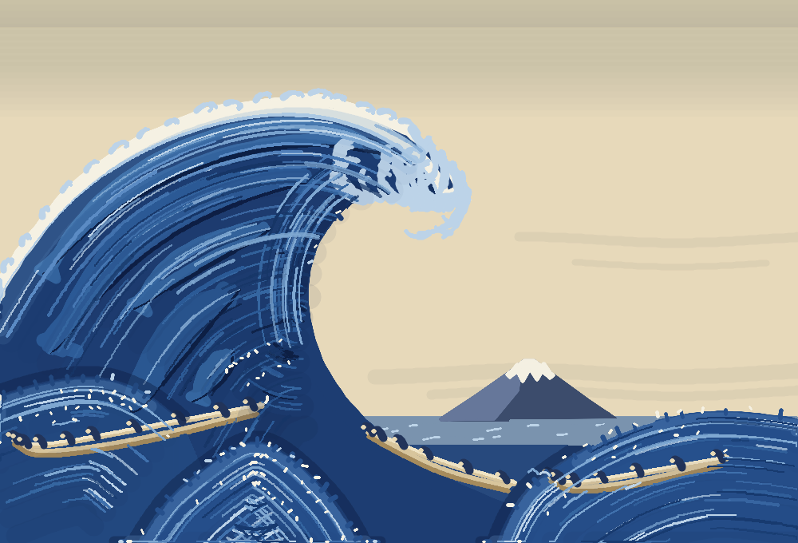

# ms-paint-mcp

**Give Claude (or any MCP client) a brush and Windows 11 Paint, and watch it paint.**

No image generation, no pasting pixels: it drives the real Paint app with a synthetic pen, one brush stroke at a time, like a person would. No fill bucket, no shape tools. Every colored area is built from overlapping strokes.

[](LICENSE)




*The Great Wave off Kanagawa, after Hokusai, painted stroke by stroke in MS Paint. [Watch it being painted](challenges/02_great_wave.gif).*


Your mouse is never moved: controls are found through UI Automation and strokes go in through a synthetic pen. While it works, Paint gets an orange border, a "Claude is drawing" label and an orange cursor that follows the pen. Mistakes get painted over on the same canvas, never fixed by starting again.

## Try it

1. Install [uv](https://docs.astral.sh/uv/) and clone this repo on Windows 11.
2. Add the server to Claude Code:

   ```
   claude mcp add ms-paint -- uv run --directory C:\path\to\ms-paint-mcp python -W ignore server.py
   ```

   Or to any other MCP client (Claude Desktop, Cursor, ...):

   ```json
   {
     "mcpServers": {
       "ms-paint": {
         "command": "uv",
         "args": ["run", "--directory", "C:\\path\\to\\ms-paint-mcp", "python", "-W", "ignore", "server.py"]
       }
     }
   }
   ```

3. Ask for a painting:

   > Paint a lighthouse at dusk in the style of Van Gogh.

   > Paint a cat as a Mondrian.

   > Paint a sunset over the sea with watercolor brushes.

If it makes you smile, a star helps other people find it.

## Tools

| Tool | What it does |
|------|--------------|
| `new_canvas(width, height, discard_unsaved=False, background=None)` | Fresh canvas, fitted to the window. `background` tones the whole canvas one color first, like a painter's toned ground; that is the only fill the server ever does. Refuses if Paint has unsaved changes. |
| `set_color(hex_color)` | Sets the brush color. |
| `stroke(points, tool, size, brush, opacity)` | One continuous stroke through image-pixel points. `tool` is brush, pencil or eraser; `brush` is any Paint brush type (Brush, Calligraphy brush, Calligraphy pen, Airbrush, Oil brush, Crayon, Marker, Natural pencil, Watercolor brush); `opacity` 1-100 for glazing and blending. |
| `painting_guide()` | Lessons learned and a per-style playbook ([LESSONS.md](LESSONS.md)), so the AI can pick brushes and strokes to suit the style you ask for. |
| `zoom(level, x, y)` | Zoom Paint in (10-1000%) on an image point, to paint and inspect small details close up; no arguments fits the whole canvas again. Pen hovers measure exactly where the canvas sits, so strokes land precisely at any zoom. |
| `undo()` | Undo the last action. |
| `view()` | Screenshot of the visible canvas: the whole painting, or a magnified close-up while zoomed in. |
| `save(path)` | Saves a new `.png`. |

## Painting challenges

A fun way to push the server: paint a famous work in the style of each artist, with brush strokes only, easiest first. Each challenge is a script in [`challenges/`](challenges) that paints in Paint and saves the painting plus a sped-up GIF of the whole Paint window next to it (`uv run challenges/01_mondrian.py`). What each one teaches goes into [LESSONS.md](LESSONS.md).

| # | Painting | Inspired by | What it tests | Status |
|---|----------|-------------|---------------|--------|
| 1 | Composition with Red, Blue and Yellow | Piet Mondrian | Straight lines and even brush coverage | Done: [painting](challenges/01_mondrian.png), [GIF](challenges/01_mondrian.gif) |
| 2 | The Great Wave | Katsushika Hokusai | Curves and shape boundaries | In progress: repainted from scratch with layered water and texture; foam and outlines still to finish ([painting so far](challenges/02_great_wave.png), [GIF](challenges/02_great_wave.gif)) |
| 3 | The Starry Night | Vincent van Gogh | Brush texture and layering | To do |
| 4 | Impression, Sunrise | Claude Monet | Blending and color transitions | To do |
| 5 | The Scream | Edvard Munch | Composition and expressive strokes | To do |
| 6 | Girl with a Pearl Earring | Johannes Vermeer | Portrait accuracy | To do |
| 7 | The Birth of Venus | Sandro Botticelli | Full-scene complexity | To do |

Each one is an original painting in the artist's style, not a copy.

## Gallery

An early painting, made before the server went brush-only (it used fills and shapes): [sunset](gallery/sunset.png).

## Caveats

- Paint comes to the front while a tool runs. Paint 11 ignores input sent to it in the background, so it can't paint behind your other windows. Your mouse stays yours, and keystrokes are only sent while Paint has the foreground.
- Tested on Paint 11.2605 at 100% display scaling. `set_color` finds the hex box by its position in the Edit colors dialog, because any UI Automation query while that dialog is open hangs Paint.

`uv run smoke_test.py` exercises every tool against real Paint (it discards the current image).
